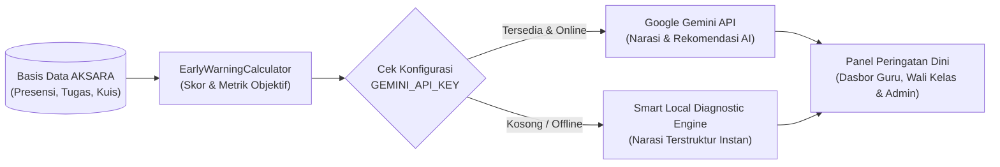

# Integrasi AI: Sistem Peringatan Dini Akademik Sekolah (*Academic Early Warning System / EWS*)

Dokumen ini menjelaskan spesifikasi teknis, arsitektur modular, indikator penilaian risiko, serta tata kelola privasi untuk fitur **AI Deteksi Dini Siswa Berisiko (*Academic Early Warning System*)** pada platform **AKSARA (Aplikasi Kegiatan Sekolah dan Akademik Terpadu)**.

---

## 1. Latar Belakang & Tujuan Fitur

Dalam kegiatan belajar mengajar di sekolah, guru mata pelajaran maupun wali kelas sering kali baru menyadari adanya siswa yang tertinggal secara akademik menjelang pembagian rapor akhir semester. Memeriksa tabel presensi, keterlambatan tugas, dan skor kuis satu per satu untuk puluhan siswa di setiap rombel juga membutuhkan waktu yang tidak sedikit.

Fitur **AI Deteksi Dini Siswa Berisiko (EWS)** dirancang untuk:
1. **Mendeteksi secara otomatis** siswa yang menunjukkan gejala penurunan performa belajar atau kehadiran sejak awal hingga pertengahan semester.
2. **Menyajikan ringkasan diagnostik berbahasa Indonesia yang jelas** beserta rekomendasi tindak lanjut (*intervensi pembimbingan*) yang mudah dipahami oleh guru pengajar, wali kelas, maupun administrator sekolah.
3. **Mempertahankan kendali penuh pada pendidik (*Human-in-the-Loop*)** — AI hanya memberikan peringatan dini dan rekomendasi pembinaan, tanpa pernah mengubah nilai rapor atau status kenaikan kelas siswa secara sepihak.

---

## 2. Variabel & Indikator Analisis Risiko

Sistem menghitung skor risiko setiap siswa di dalam kelas (`TeacherAssignment`) maupun lintas mata pelajaran berdasarkan **4 sumber data riil** yang tercatat di basis data AKSARA:

| No | Variabel Data | Tabel Sumber | Bobot Risiko | Indikator Pemicu Peringatan |
| :--- | :--- | :--- | :--- | :--- |
| **1** | **Persentase Kehadiran** | `attendance_records`, `attendance_sessions` | **35%** | Kehadiran $< 75\%$ (*Risiko Tinggi*) atau $75\% - 84\%$ (*Risiko Sedang*). Sesi berstatus *Izin/Sakit* yang disetujui tidak mengurangi persentase kehadiran. |
| **2** | **Frekuensi Alpa (`absent`)** | `attendance_records` | **15%** | Tercatat $\ge 2$ kali Alpa tanpa keterangan pada suatu mata pelajaran. |
| **3** | **Kedisiplinan Tugas** | `assignments`, `assignment_submissions` | **25%** | Terdapat tugas terbit (*published*) yang melewati tenggat waktu (`due_at`) tanpa pengumpulan, atau sering terlambat mengumpulkan (`submitted_at > due_at`). |
| **4** | **Capaian Nilai Akademik (KKM)** | `assignment_submissions`, `quiz_attempts` | **25%** | Rata-rata persentase nilai tugas dan kuis berada di bawah KKM ($< 60\%$ *Risiko Tinggi*, $60\% - 69\%$ *Risiko Sedang*). |

---

## 3. Klasifikasi Status Risiko Siswa

Berdasarkan agregasi keempat variabel di atas, sistem mengelompokkan siswa ke dalam **3 tingkat status**:

1. **Risiko Tinggi (*Perlu Pembimbingan Segera*)** — Skor Risiko $\ge 60$
   - **Kriteria**: Kehadiran di bawah $75\%$, atau rata-rata nilai di bawah $55$, atau memiliki $\ge 2$ tugas wajib yang belum dikumpulkan setelah lewat tenggat waktu.
   - **Rekomendasi AI**: Pembimbingan langsung oleh guru mata pelajaran bersama wali kelas/guru BK, komunikasi dengan orang tua/wali siswa bila diperlukan, dan pemberian penugasan remedial terarah.
2. **Risiko Sedang (*Perlu Pemantauan*)** — Skor Risiko $30 - 59$
   - **Kriteria**: Kehadiran antara $75\% - 84\%$, atau rata-rata nilai $55 - 69$, atau tercatat mengumpulkan tugas melewati batas waktu.
   - **Rekomendasi AI**: Pengingat disiplin kehadiran di kelas dan umpan balik perbaikan pada bagian materi pelajaran yang belum dikuasai.
3. **Terkendali (*Aman / On-Track*)** — Skor Risiko $< 30$
   - **Kriteria**: Kehadiran $\ge 85\%$, tugas dikumpulkan tepat waktu, dan rata-rata evaluasi $\ge 70$.
   - **Rekomendasi AI**: Pertahankan konsistensi belajar hingga evaluasi akhir semester.

---

## 4. Arsitektur Hibrida AI (LLM API + *Smart Local Engine*)

Agar sistem siap digunakan baik pada lingkungan sekolah maupun saat **presentasi/demo** (termasuk ketika tidak ada koneksi internet atau tanpa kunci API berbayar), fitur AI EWS menggunakan **Arsitektur Dua Lapis (*Dual-Engine Architecture*)**:



1. **Lapis 1 — Perhitungan Kuantitatif Deterministik (`EarlyWarningCalculator`)**:
   - Seluruh angka persentase kehadiran, jumlah alpa, tugas terlewat, dan rata-rata nilai dihitung secara **pasti oleh PHP/Eloquent** dari basis data (bukan ditebak oleh AI), sehingga **bebas dari halusinasi angka (*zero numeric hallucination*)**.
2. **Lapis 2 — Penyusunan Narasi & Rekomendasi Intervensi (`EarlyWarningNarrative`)**:
   - **Mode Cloud LLM (Opsional via `.env`)**: Jika `GEMINI_API_KEY` diisi, metrik kuantitatif dikirim ke model Gemini untuk dirangkai menjadi ringkasan evaluasi kelas dan saran intervensi yang kontekstual.
   - **Mode Lokal Mandiri (*Default Fallback*)**: Jika `GEMINI_API_KEY` kosong atau koneksi gagal, sistem otomatis menggunakan *Rule-Based Natural Language Generator* berbahasa Indonesia yang menghasilkan analisis lengkap dalam waktu $< 10\text{ ms}$.

---

## 5. Konfigurasi Lingkungan (`.env`)

Tambahkan variabel berikut pada berkas `.env` (opsional, sistem tetap berjalan penuh meskipun dikosongkan):

```dotenv
AI_EWS_ENABLED=true
AI_EWS_PROVIDER=local
GEMINI_API_KEY=
GEMINI_MODEL=gemini-2.0-flash
```

---

## 6. Struktur Modul Kode & Titik Integrasi Antarmuka

Implementasi AI EWS dipisahkan ke dalam berkas-berkas modular berukuran ringkas agar mudah dipelihara dan diuji:

| Berkas | Tanggung Jawab | Ukuran Aktual |
| :--- | :--- | :---: |
| `app/Services/Ai/EarlyWarningCalculator.php` | Menghitung metrik kehadiran, alpa, ketepatan tugas, rata-rata nilai, dan skor risiko (`0–100`) bebas N+1 query | ~285 baris |
| `app/Services/Ai/EarlyWarningNarrative.php` | Menyusun diagnosis faktor risiko, saran pembimbingan guru, panduan belajar siswa, & ringkasan eksekutif (mendukung Gemini API & *Local Fallback*) | ~165 baris |
| `app/Http/Controllers/EarlyWarningController.php` | Menangani rute `GET /early-warning` dengan pemisahan otorisasi Admin, Guru, dan Siswa | ~58 baris |
| `resources/views/components/early-warning-panel.blade.php` | Komponen ringkas Peringatan Dini AI pada halaman `/dashboard` dan `/classes/{classroom}` | ~78 baris |
| `resources/views/early-warning/index.blade.php` | Halaman penuh Dasbor AI Deteksi Dini untuk Admin & Guru dengan filter Kelas, Jurusan, Rombel, Status Risiko, dan Pencarian NIS/Nama | ~188 baris |
| `resources/views/early-warning/student.blade.php` | Halaman Evaluasi Dini & Panduan Belajar AI khusus Siswa beserta rincian risiko per mata pelajaran | ~140 baris |
| `public/css/app/early-warning.css` | Modul CSS neumorfik untuk kartu KPI risiko, lencana status, dan *progress meter* skor risiko | ~143 baris |
| `tests/Feature/EarlyWarningSystemTest.php` | Pengujian otomatis akurasi skor risiko, pengecualian sesi izin (`excused`), filter RBAC, dan tampilan antarmuka | ~152 baris |

### Titik Akses Pengguna di Aplikasi
1. **Menu Sidebar Utama**: Tautan **AI Peringatan Dini** (`/early-warning`) tersedia langsung di bilah navigasi kiri untuk seluruh peran (`admin`, `teacher`, `student`).
2. **Beranda (`/dashboard`)**: Menampilkan *widget* ringkasan eksekutif AI di bagian atas beranda beserta jumlah siswa berstatus *Risiko Tinggi*, *Risiko Sedang*, dan *Terkendali* (atau status evaluasi personal bagi siswa).
3. **Ruang Kelas (`/classes/{classroom}`)**: Menampilkan ringkasan AI EWS spesifik untuk mata pelajaran tersebut beserta tombol pintas menuju `/early-warning?class_id={id}`.

---

## 7. Keamanan, Otorisasi, dan Privasi Data

1. **Pembatasan Akses Berbasis Peran (`RBAC`)**:
   - **Administrator Sekolah**: Dapat memantau ringkasan siswa berisiko di seluruh jurusan dan rombel kelas.
   - **Guru Pengajar**: Hanya dapat melihat analisis risiko untuk siswa yang terdaftar pada kelas mata pelajaran (`TeacherAssignment`) yang diajarnya.
   - **Siswa**: Hanya dapat melihat indikator status belajar miliknya sendiri sebagai pengingat belajar mandiri (tidak dapat melihat status teman sekelasnya).
2. **Perlindungan Data Sensitif**:
   - Kata sandi (`password`), kode OTP 2FA, token sesi, maupun berkas surat izin tidak pernah dikirim ke layanan eksternal.
