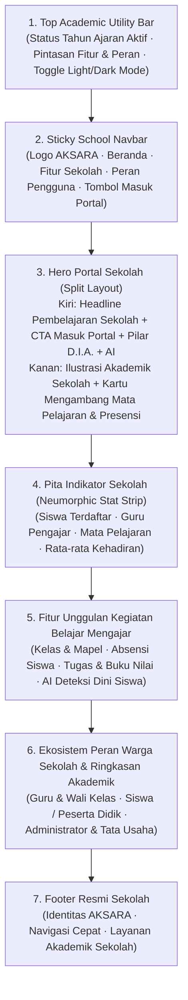

# Spesifikasi Desain Halaman Awal (*Landing Page*) Portal Sekolah AKSARA

**Identitas Aplikasi:** **AKSARA — Aplikasi Kegiatan Sekolah dan Akademik Terpadu**  
**Sistem Desain Visual:** *Soft 3D Neumorphic Academic Slate* & *Deep Navy* yang selaras penuh dengan halaman dalam (`/login`, `/dashboard`, `/classes`, `/early-warning`).

---

## 1. Tujuan & Prinsip Desain

Halaman awal (`/`) dirancang khusus sebagai wajah resmi **Portal Pembelajaran & Akademik Sekolah** yang bersih, profesional, dan mudah dipahami oleh guru, siswa, wali kelas, maupun staf tata usaha sekolah:

1. **Bersih, Fokus, dan Profesional untuk Lingkungan Sekolah**:
   - Menampilkan identitas sekolah yang jelas tanpa formulir ganda atau daftar katalog mentah yang membingungkan di halaman depan.
   - Mengarahkan warga sekolah langsung ke alur autentikasi resmi (`/login`) atau dasbor (`/dashboard`) dengan tombol aksi yang tegas.
2. **Konsistensi Visual Penuh dengan Halaman Dalam**:
   - Menggunakan palet warna, tipografi (`Plus Jakarta Sans`), sudut membulat (`--radius-lg: 24px`), dan bayangan lembut (*Soft 3D Neumorphic Surface* `#e3e7ee` & *Deep Academic Navy* `#1a2842`) yang identik dengan portal internal AKSARA.
   - Mendukung **Sakelar Tema Terang/Gelap (*Light/Dark Mode*)** yang tersinkronisasi melalui `localStorage('lms_theme')`.
3. **Kerangka Pembelajaran Terstruktur (*D.I.A. + AI Early Warning*)**:
   - Menyajikan empat pilar utama kegiatan belajar mengajar di sekolah: **Delivery** (Kelas & Materi Pelajaran), **Interaction** (Absensi Siswa Digital), **Assessment** (Tugas, Kuis & Buku Nilai), dan **AI Deteksi Dini Siswa Berisiko**.

---

## 2. Struktur Seksi Halaman Awal (`/`)

---

## 3. Penyelarasan Palet Warna & Tema

| Token Desain | Mode Terang (*Light — Default*) | Mode Gelap (*Dark Slate*) | Penggunaan pada Halaman Awal |
| :--- | :--- | :--- | :--- |
| `--bg-page` | `#e3e7ee` (*Soft Neumorphic Slate*) | `#172030` (*Dark Academic Slate*) | Latar belakang utama halaman & kartu neumorfik |
| `--bg-card-alt` | `#dce1ea` | `#141c2b` | Latar seksi bergantian (*Peran Warga Sekolah*) |
| `--navy` | `#1a2842` (*Deep Academic Navy*) | `#253a56` | Aksentuasi *Hero Portal*, *Top Utility Bar*, & *Footer* |
| `--blue` | `#2b6cb0` (*AKSARA Primary Blue*) | `#4d8fd9` | Tombol utama, ikon fitur, & indikator aktif |
| `--amber` | `#c07a2e` (*Warm Academic Gold*) | `#df9745` | Sorotan judul & lencana Tahun Ajaran aktif |
| `--sage` | `#2e7d54` (*Academic Emerald*) | `#48a674` | Indikator kehadiran & status sistem aktif |

---

## 4. Struktur Berkas Modular

Seluruh kode halaman depan dipisahkan ke dalam berkas-berkas ringkas agar mudah dipelihara:

| Berkas | Peran & Tanggung Jawab |
| :--- | :--- |
| `app/Http/Controllers/LandingController.php` | Mengambil statistik sekolah (`$stats`) dan tahun ajaran aktif (`$activeYear`) secara ringan |
| `resources/views/landing.blade.php` | Kerangka utama HTML halaman depan + sinkronisasi tema `lms_theme` |
| `resources/views/landing/navbar-hero.blade.php` | *Top Academic Bar*, *Navbar* sekolah, dan *Hero* split-layout dengan ilustrasi visual |
| `resources/views/landing/sections.blade.php` | Pita statistik sekolah, 4 kartu fitur unggulan KBM, dan panduan peran warga sekolah |
| `resources/views/landing/footer-scripts.blade.php` | *Footer* resmi sekolah serta skrip *toggle* tema terang/gelap dan menu seluler |
| `public/css/landing/base-navbar.css` | Token warna neumorfik (terang & gelap), *Top Bar*, dan *Navbar* |
| `public/css/landing/hero.css` | Gaya visual *Hero* sekolah, lencana D.I.A., dan bingkai ilustrasi mengambang |
| `public/css/landing/sections-footer.css` | Gaya visual pita statistik, kartu fitur unggulan, peran sekolah, dan *footer* |
