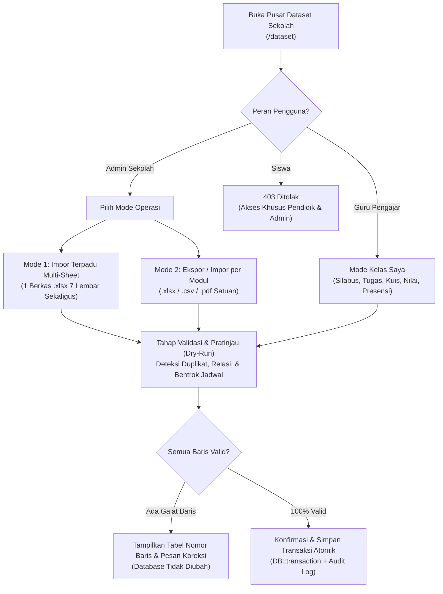

# Spesifikasi Fitur: Pusat Ekspor & Impor Dataset Sekolah Terpadu (*School Dataset Hub*)

Dokumen ini memuat rancangan fungsional, cakupan dataset sekolah, matriks hak akses (*Role-Based Access Control*), alur impor terpadu multi-lembar, standar keamanan validasi berkas, serta arsitektur kode modular untuk fitur **Pusat Ekspor & Impor Dataset Sekolah Terpadu** pada platform **AKSARA (Aplikasi Kegiatan Sekolah dan Akademik Terpadu)**.

---

## 1. Latar Belakang & Tujuan Utama

Pada pelaksanaan administrasi akademik maupun pergantian tahun ajaran/semester, tata usaha sekolah dan guru pengajar umumnya mengelola data dalam bentuk lembar kerja Excel atau CSV (seperti daftar NIS siswa, NIP guru, pembagian rombel, jadwal pelajaran, hingga rekap nilai). Memasukkan ratusan baris data satu per satu melalui formulir web memakan waktu lama dan rawan kesalahan ketik.

Fitur **Pusat Ekspor & Impor Dataset Sekolah Terpadu** dirancang untuk:
1. **Impor Struktur Akademik Terpadu (*Multi-Sheet Workbook*)**: Memungkinkan administrator sekolah memasukkan seluruh data induk akademik secara serentak melalui **satu berkas templat buku kerja resmi (`.xlsx` Multi-Sheet)** maupun berkas `.csv` standar.
2. **Memudahkan Operasional Harian Guru & Tata Usaha**: Memfasilitasi impor dan ekspor data kegiatan belajar mengajar (tugas, daftar nilai, presensi harian, silabus pertemuan, hingga bank soal kuis) secara praktis dan terintegrasi.
3. **Menjamin Validitas & Keamanan Data Akademik**: Dilengkapi tahap pratinjau validasi (*Dry-Run Preview*), pencocokan kode alami (`NIS`, `NIP`, `Kode Mapel`, `Nama Rombel`) tanpa perlu mengetahui ID internal database, eksekusi transaksi atomik (`DB::transaction`), serta pembatasan hak akses ketat per peran.

---

## 2. Kebijakan Hak Akses Peran: Apakah Siswa Perlu Diberi Akses?

> **Keputusan Arsitektur & Keamanan: Siswa (`student`) TIDAK diberikan akses ke fitur Impor maupun Ekspor Dataset Massal.**  
> Sistem ini **hanya dapat dioperasikan oleh Administrator Sekolah (`admin`) dan Guru Pengajar (`teacher`)** sesuai batas kewenangan masing-masing.

### Alasan Teknis, Akademik, dan Privasi Data:
1. **Integritas Data Akademik**: Memberikan akses impor kepada siswa berisiko membuka celah manipulasi skor nilai, status kehadiran/alpa, maupun tenggat pengumpulan tugas. Pengumpulan tugas oleh siswa tetap dilakukan secara individual melalui halaman ruang kelas resmi (`POST /assignments/{assignment}/submit`).
2. **Perlindungan Data Pribadi Warga Sekolah**: Dataset kelas atau sekolah memuat data sensitif rekan sekelas (NIS, alamat email, rincian nilai evaluasi, dan catatan ketidakhadiran/izin). Siswa tidak boleh mengunduh dataset massal milik rombel atau sekolah.
3. **Alternatif Aman untuk Siswa (*Self-Service Read-Only*)**: Siswa tidak memerlukan fitur impor/ekspor dataset, melainkan cukup menggunakan fitur **Lihat/Cetak Rekap Nilai & Kehadiran Pribadi** pada menu Laporan yang sudah terkunci ketat hanya untuk data dirinya sendiri (`student_id` miliknya).

### Matriks Hak Akses (*RBAC Matrix*)

| Peran Pengguna | Hak Impor Dataset | Hak Ekspor Dataset | Batas Cakupan Data (*Data Scope*) |
| :--- | :--- | :--- | :--- |
| **Administrator Sekolah (`admin`)** | **Diizinkan Penuh** (Data Induk Sekolah + Data Operasional KBM + Buku Kerja Terpadu 7-Sheet) | **Diizinkan Penuh** (`.xlsx`, `.csv`, `.pdf`) | Seluruh tahun ajaran, jurusan, tingkat kelas, rombel, guru, dan siswa di sekolah. |
| **Guru Pengajar (`teacher`)** | **Diizinkan Terbatas** (Hanya Data Operasional KBM: Pertemuan, Tugas, Soal Kuis, Nilai, & Presensi) | **Diizinkan Terbatas** (Peserta Kelas, Buku Nilai, Presensi, & Analitik AI Kelas) | **Hanya kelas mata pelajaran (`TeacherAssignment`) yang diajar oleh guru tersebut.** Tidak dapat mengubah akun pengguna, rombel, atau kelas guru lain. |
| **Siswa (`student`)** | **Ditolak (`403 Forbidden`)** | **Ditolak (`403 Forbidden`)** pada Pusat Dataset | Hanya dapat melihat & mencetak laporan nilai/presensi pribadinya sendiri melalui menu standar siswa. |

---

## 3. Cakupan Lengkap Dataset Sekolah yang Difasilitasi

Selain data siswa, guru, tugas, nilai, dan absensi yang menjadi kebutuhan utama, sistem ini dilengkapi **administrasi pelengkap sekolah lainnya** yang terhubung langsung dengan skema basis data AKSARA (total **15 modul dataset terintegrasi**):

### Kategori A — Data Induk & Administrasi Sekolah (*Khusus Admin Sekolah*)
Digunakan saat penyiapan tahun ajaran, penataan rombel/jadwal, atau pemutakhiran data tata usaha:

| No | Modul Dataset | Tabel Sasaran | Kolom Utama Impor / Ekspor | Manfaat Praktis bagi Sekolah |
| :---: | :--- | :--- | :--- | :--- |
| **1** | **Tahun Ajaran & Kalender** | `academic_years` | `nama_tahun_ajaran`, `tanggal_mulai`, `tanggal_selesai` | Menyiapkan periode akademik sekolah secara terstandar. |
| **2** | **Jurusan & Tingkat Kelas** | `programs`, `year_levels` | `kode_jurusan`, `nama_jurusan`, `nomor_tingkat`, `nama_tingkat` | Mendukung struktur SMA (`MIPA`/`IPS`/Fase E–F) maupun SMK (`RPL`/`TKJ`/`AKL`, Kelas X–XII). |
| **3** | **Rombongan Belajar (Rombel)** | `blocks` | `tahun_ajaran`, `semester`, `kode_jurusan`, `nomor_tingkat`, `nama_rombel` | Membuat puluhan rombel (mis. `X-MIPA-1` s.d. `XII-IPS-4`) sekaligus. |
| **4** | **Data Guru & Pendidik** | `users`, `teachers` | `nip`, `nama_lengkap`, `email`, `status_akun` | Mendaftarkan seluruh dewan guru sekaligus dan menyiapkan undangan aktivasi email aman. |
| **5** | **Data Siswa & Penempatan Rombel** | `users`, `students`, `enrollments` | `nis`, `nama_lengkap`, `email`, `kode_jurusan`, `nomor_tingkat`, `nama_rombel` | Memasukkan ratusan siswa sekaligus dan **otomatis mendaftarkan (*auto-enroll*)** siswa ke seluruh mapel di rombelnya. |
| **6** | **Katalog Mata Pelajaran & JP** | `subjects`, `subject_prerequisites` | `kode_mapel`, `nama_mapel`, `jp_total`, `jp_teori`, `jp_praktik`, `kode_jurusan`, `nomor_tingkat`, `semester`, `prasyarat` | Memetakan struktur kurikulum sekolah beserta beban Jam Pelajaran (JP). |
| **7** | **SK Pembagian Tugas Mengajar** | `teacher_assignments` | `nip_guru`, `kode_mapel`, `nama_rombel`, `tahun_ajaran`, `semester` | Menghubungkan guru pengajar dengan mata pelajaran dan rombel secara massal. |
| **8** | **Jadwal Pelajaran & Ruang/Lab** | `class_schedules` | `nama_rombel`, `kode_mapel`, `hari`, `jam_mulai`, `jam_selesai`, `ruang_kelas` | Menyusun jadwal mingguan sekolah lengkap dengan **deteksi otomatis bentrok jam guru & ruangan**. |
| **9** | **Pengumuman Resmi Sekolah** | `announcements` | `judul`, `isi_pengumuman`, `target_rombel_opsional`, `tanggal_terbit` | Mempublikasikan agenda kalender akademik/ujian dari lembar kerja tata usaha. |

### Kategori B — Data Operasional Kegiatan Belajar Mengajar (*Admin & Guru Pengajar*)
Digunakan oleh guru mata pelajaran maupun admin akademik untuk mempercepat pengelolaan kelas sepanjang semester:

| No | Modul Dataset | Tabel Sasaran | Kolom Utama Impor / Ekspor | Manfaat Praktis bagi Guru & Sekolah |
| :---: | :--- | :--- | :--- | :--- |
| **10** | **Silabus / Daftar Pertemuan** | `lessons` | `urutan_pertemuan`, `judul_topik`, `tujuan_ringkas`, `isi_materi`, `status` | Guru dapat langsung mengunggah rencana 16 pertemuan satu semester dari berkas silabus/RPP. |
| **11** | **Daftar Tugas Kelas** | `assignments` | `judul_tugas`, `deskripsi`, `instruksi`, `tenggat_waktu`, `poin_maksimal`, `status` | Menyiapkan seluruh daftar penugasan terstruktur dalam satu kali unggah. |
| **12** | **Rekap Nilai Siswa (*Gradebook*)** | `assignment_submissions`, `grades` | `nis`, `nama_siswa`, `judul_penilaian`, `skor`, `poin_maksimal`, `umpan_balik_guru` | Guru dapat mengunduh daftar siswa kelasnya, mengisi nilai & catatan evaluasi di Excel secara *offline*, lalu mengunggahnya kembali. |
| **13** | **Presensi / Absensi Harian** | `attendance_sessions`, `attendance_records`, `attendance_logs` | `tanggal`, `jam_mulai`, `jam_selesai`, `nis`, `status_kehadiran` (`Hadir`/`Terlambat`/`Izin`/`Alpa`), `menit_terlambat`, `keterangan` | Rekapitulasi absensi harian maupun sinkronisasi jurnal kehadiran kelas disertai pencatatan *audit log* otomatis. |
| **14** | **Bank Soal Kuis Pilihan Ganda** | `quizzes`, `quiz_questions` | `judul_kuis`, `durasi_menit`, `pertanyaan`, `opsi_a`, `opsi_b`, `opsi_c`, `opsi_d`, `kunci_jawaban`, `poin` | Menghemat waktu guru saat menyiapkan 20–50 butir soal latihan/evaluasi tanpa mengetik satu per satu di form web. |
| **15** | **Laporan AI Deteksi Dini Siswa** *(Khusus Ekspor)* | Agregasi `EarlyWarningCalculator` | `nis`, `nama_siswa`, `rombel`, `persen_kehadiran`, `jumlah_alpa`, `tugas_terlewat`, `rata_nilai`, `skor_risiko`, `status_risiko`, `rekomendasi_ai` | Menghasilkan dokumen siap rapat bagi Wali Kelas, Guru BK, dan Kepala Sekolah. |

---

## 4. Dua Mode Operasi: Impor Terpadu Multi-Sheet & Operasional Modular

Untuk mengakomodasi sinkronisasi data skala penuh maupun pembaruan harian per modul, sistem menyediakan **dua mode kerja**:



### Mode 1 — Impor Data Akademik Sekolah Terpadu (`1 Berkas .xlsx Multi-Sheet`)
Khusus untuk **Admin Sekolah** saat menyinkronkan struktur data sekolah secara menyeluruh:
- Admin mengunduh **`Template_Data_Sekolah_Terpadu_AKSARA.xlsx`** yang berisi **7 *sheet* berurutan** lengkap dengan contoh pengisian dan struktur kolom:
  1. `01_Tahun_Ajaran`
  2. `02_Jurusan_Tingkat`
  3. `03_Rombel`
  4. `04_Data_Guru`
  5. `05_Mata_Pelajaran`
  6. `06_Kelas_dan_Jadwal`
  7. `07_Data_Siswa`
- Ketika diunggah kembali, sistem memvalidasi keterhubungan antar-*sheet* secara berurutan (misalnya memastikan kode rombel pada `07_Data_Siswa` benar-benar terdaftar pada `03_Rombel`, serta NIP guru pada `06_Kelas_dan_Jadwal` terdaftar pada `04_Data_Guru`).
- Seluruh entitas dibuat atau diperbarui sekaligus dalam **satu transaksi basis data utuh**.

### Mode 2 — Impor & Ekspor Modular per Entitas (`.xlsx` / `.csv` / `.pdf`)
Digunakan oleh **Admin** maupun **Guru Pengajar** kapan saja:
- **Unduh Templat Cerdas (*Context-Aware Template*)**: Saat guru memilih kelas `X-MIPA-1 — Matematika` lalu mengunduh templat **Nilai** atau **Presensi**, berkas `.xlsx`/`.csv` yang terunduh **sudah otomatis terisi daftar NIS dan Nama Siswa di kelas tersebut** (*pre-filled roster*), sehingga guru tinggal mengetik angka nilai atau status kehadiran saja.
- **Mode *Upsert* Aman (Tambah & Perbarui Tanpa Duplikat)**:
  - Jika `NIS` / `NIP` / `Kode Mapel` belum ada → sistem menambahkan data baru.
  - Jika sudah ada dalam cakupan yang sah → sistem memperbarui data secara terkontrol tanpa menggandakan baris atau menghapus riwayat lama.

---

## 5. Standar Keamanan, Validasi, & Integritas Data

Mengingat fitur impor massal menyentuh banyak tabel akademik penting, pengamanan berlapis wajib diterapkan:

1. **Kewajiban Tahap Pratinjau (*Mandatory Two-Step Dry-Run*)**
   - Unggahan berkas (`POST /dataset/preview`) **tidak pernah langsung menyimpan ke basis data**.
   - Sistem menampilkan ringkasan perubahan (*jumlah data baru, jumlah data diperbarui, dan daftar peringatan/galat per nomor baris*). Penyimpanan baru dieksekusi saat pengguna menekan tombol konfirmasi (`POST /dataset/commit`) dengan token pratinjau sesi yang tervalidasi.
2. **Transaksi Basis Data Atomik (`DB::transaction`)**
   - Apabila terdapat satu saja baris tidak valid atau terjadi bentrok jadwal mengajar/ruangan (`ScheduleConflicts`), seluruh proses dibatalkan (*rollback* 100%) sehingga basis data tidak pernah menyimpan data setengah jadi.
3. **Perlindungan terhadap *CSV / Spreadsheet Formula Injection***
   - Saat ekspor `.xlsx` maupun `.csv`, seluruh nilai teks ditulis sebagai *inline string* aman dan nilai yang diawali karakter pemicu rumus (`=`, `+`, `-`, `@`, `\t`, `\r`) dinetralkan agar tidak mengeksekusi makro/formula berbahaya di perangkat pengguna.
4. **Perlindungan Berkas `.xlsx` & `.csv` (*Anti-XXE & File Limits*)**
   - Hanya menerima berkas `.csv` dan `.xlsx` murni (maksimal `5 MB` dan batas wajar baris per unggahan, mis. `2.000 baris`), pengodean UTF-8 valid (mendukung UTF-8 BOM dari Excel Indonesia, baik pemisah koma `,` maupun titik koma `;` khas pengaturan regional Indonesia!).
   - Pembacaan XML internal `.xlsx` menggunakan `ZipArchive` + parser XML tanpa entitas eksternal (`LIBXML_NONET`) serta batas rasio dekompresi untuk mencegah serangan *Zip Bomb*.
5. **Keamanan Kredensial & Akun Pengguna**
   - **Tidak pernah mengekspor atau menerima kata sandi teks biasa (*plaintext password*)** di dalam berkas Excel/CSV.
   - Akun guru/siswa baru dari hasil impor dibuat dengan kata sandi acak ter-hash (`bcrypt`) dan diaktifkan melalui mekanisme resmi undangan *Signed URL* via email antrean (`queue`) atau aktivasi terkontrol oleh Admin Sekolah.
6. **Jendela Waktu Guru & Log Audit Otomatis (`dataset_audit_logs` & `attendance_logs`)**
   - Aturan akademik AKSARA tetap ditegakkan pada jalur impor: guru hanya dapat mengimpor perubahan presensi dalam jendela edit 7 hari terakhir (presensi lampau > 7 hari hanya dapat dikoreksi oleh Admin dengan alasan audit).
   - Setiap aktivitas impor dan ekspor dicatat ke log audit (pelaku, peran, jenis dataset, waktu, IP, jumlah baris ditambahkan/diperbarui) untuk akuntabilitas tata usaha sekolah.

---

## 6. Dukungan Regional Sekolah di Indonesia

Di banyak komputer sekolah di Indonesia, Microsoft Excel menggunakan pengaturan regional Bahasa Indonesia yang mengekspor berkas CSV dengan pemisah **titik koma (`;`)** alih-alih koma (`,`).
- Parser impor pada Pusat Dataset AKSARA dirancang **mendeteksi otomatis (*auto-detect delimiter*)** antara koma (`,`) dan titik koma (`;`), serta mendukung berkas **`.xlsx` asli (OpenXML)** tanpa memerlukan instalasi pustaka berat tambahan karena memanfaatkan ekstensi `ZipArchive` dan `SimpleXML/DOM` bawaan PHP 8.2 (sejalan dengan `ReportExport` yang sudah ada di AKSARA).

---

## 7. Struktur Kode Modular (Rapi & Mudah Dirawat)

Seluruh kode fitur ini dipisahkan ke dalam berkas-berkas modular berukuran ringkas agar mudah dipelihara dan diuji:

```text
app/
├── Http/
│   └── Controllers/
│       └── Dataset/
│           ├── DatasetHubController.php          # Halaman utama Pusat Dataset, pilih kelas & riwayat audit
│           ├── DatasetTemplateController.php     # Unduh templat kosong / pre-filled .xlsx & .csv
│           ├── DatasetImportController.php       # Endpoint preview (dry-run), commit transaksi, & cancel
│           └── DatasetExportController.php       # Endpoint ekspor dataset terfilter ke .xlsx, .csv, .pdf
├── Models/
│   └── DatasetAuditLog.php                       # Model pencatatan riwayat ekspor & impor dataset
└── Services/
    └── Dataset/
        ├── SpreadsheetCodec.php                  # Pembaca & penulis .xlsx (Multi-Sheet) + .csv (, / ;) aman dari injeksi
        ├── DatasetRegistry.php                   # Definisi skema kolom, label Indonesia, & hak akses 15 modul
        ├── DatasetImportRunner.php               # Orkestrator dry-run savepoint & commit transaksi atomik
        ├── DatasetExporter.php                   # Ekspor & generator templat pre-filled bebas N+1 query
        └── Importers/
            ├── ImportHelpers.php                 # Resolusi relasi kode alami (NIS, NIP, Rombel, Mapel) & format waktu
            ├── MasterSchoolImporter.php          # Impor Tahun Ajaran, Jurusan, Tingkat, Rombel, Mapel, Pengumuman
            ├── RosterScheduleImporter.php        # Impor Guru, Siswa (+ Auto-Enrollment), SK Mengajar, & Jadwal
            └── ClassroomActivityImporter.php     # Impor Pertemuan, Tugas, Soal Kuis, Nilai, & Presensi (+ Audit Log)

routes/
└── dataset.php                                   # Definisi rute terproteksi Pusat Dataset (tanpa closure)

database/
└── migrations/
    └── 2026_11_07_000001_create_dataset_audit_logs_table.php

resources/
└── views/
    └── dataset/
        ├── index.blade.php                       # Antarmuka utama Pusat Ekspor & Impor Dataset Sekolah
        ├── preview.blade.php                     # Tampilan tabel pratinjau (dry-run), status validasi, & tombol konfirmasi
        └── partials/
            ├── master-bundle-card.blade.php      # Panel Impor Terpadu Multi-Sheet 7 Lembar (Admin)
            ├── module-grid.blade.php             # Kartu modul dataset terkelompokkan sesuai peran Admin / Guru
            └── audit-table.blade.php             # Tabel riwayat audit impor & ekspor terbaru

public/
└── css/
    └── app/
        └── dataset.css                           # Gaya visual neumorfik khusus Pusat Dataset

tests/
└── Feature/
    └── SchoolDatasetHubTest.php                  # Pengujian otomatis RBAC (403 Siswa, Scope Guru, Full Admin), Buku Kerja 7-Sheet, & CSV Indonesia
```

---

## 8. Rancangan Rute & Titik Integrasi Navigasi

### Rute Terproteksi (`auth`, `active`, `verified`, serta pembatasan peran `admin` / `teacher`)
| Metode | URI | Controller | Keterangan |
| :--- | :--- | :--- | :--- |
| `GET` | `/dataset` | `DatasetHubController@index` | Halaman utama Pusat Ekspor & Impor Dataset Sekolah (menyesuaikan tampilan Admin vs Guru; `403` bagi Siswa) |
| `GET` | `/dataset/templates/{module}` | `DatasetTemplateController@download` | Mengunduh templat `.xlsx` / `.csv` (termasuk buku kerja terpadu 7-*sheet* atau *roster* kelas guru) |
| `POST` | `/dataset/preview` | `DatasetImportController@preview` | Memvalidasi berkas unggahan dan menampilkan pratinjau baris tanpa menulis ke database |
| `POST` | `/dataset/commit` | `DatasetImportController@commit` | Mengeksekusi penyimpanan data tervalidasi dalam satu `DB::transaction` |
| `GET` | `/dataset/export/{module}` | `DatasetExportController@download` | Mengekspor dataset sekolah/kelas ke format `.xlsx`, `.csv`, atau `.pdf` |

### Titik Akses Antarmuka (UI)
1. **Menu Sidebar Kiri (`sidebar.blade.php`)**: Menu **Ekspor & Impor Data** hanya muncul bagi peran **Administrator Sekolah** dan **Guru Pengajar** (tidak ditampilkan pada sidebar Siswa).
2. **Pintasan Kontekstual di Ruang Kelas (`/classes/{classroom}`)**: Tombol ringkas **Impor / Ekspor Kelas** bagi Guru Pengajar & Admin untuk langsung mengelola nilai, presensi, tugas, atau soal kuis pada kelas tersebut.
3. **Pintasan di Halaman Setup Akademik (`/admin/setup`)**: Kartu pintas menuju **Buku Kerja Data Terpadu (`.xlsx` 7-Sheet)** bagi admin sekolah yang ingin mengunggah seluruh struktur dari satu berkas Excel.

---

## 9. Ringkasan Rekomendasi Siap Eksekusi

1. **Hak Akses**: Dikunci ketat hanya untuk **Administrator Sekolah** (*cakupan penuh seluruh sekolah*) dan **Guru Pengajar** (*cakupan khusus kelas ajarnya sendiri*). **Siswa tidak diberi akses impor/ekspor dataset** demi keamanan nilai, integritas presensi, dan privasi data rekan sekelas.
2. **Kelengkapan Data**: Mencakup **15 modul dataset sekolah** (9 modul data induk & administrasi tata usaha + 6 modul operasional KBM kelas termasuk analitik AI).
3. **Dukungan Format Berkas**: Mendukung **1 berkas Excel Multi-Sheet (`Template_Data_Sekolah_Terpadu_AKSARA.xlsx`)** untuk memasukkan data akademik sekolah sekaligus, serta mendukung CSV pemisah koma (`,`) maupun titik koma (`;`) khas Excel Indonesia.

