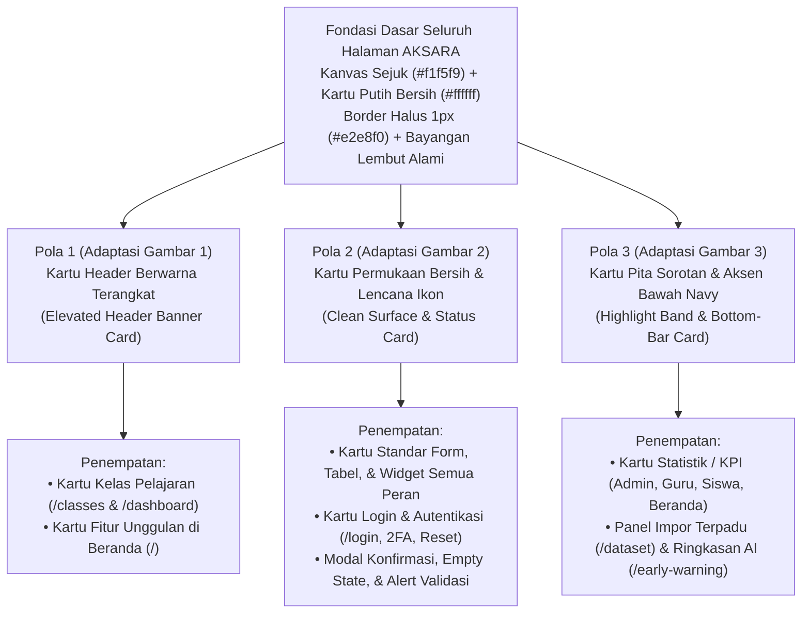

# Spesifikasi Pembaruan Desain Kartu & Permukaan Antarmuka (*Clean Elevated Card System*)

Dokumen ini merinci spesifikasi dan implementasi penggantian menyeluruh gaya kotak **3D Neumorphic Menonjol (*Extruded/Inset Neumorphism*)** menjadi sistem antarmuka **Clean Flat-Elevated Academic UI** di seluruh halaman dan seluruh peran pengguna pada **AKSARA (Aplikasi Kegiatan Sekolah dan Akademik Terpadu)**.

> **Prinsip Utama:** Pembaruan ini **murni berfokus pada kerapian visual CSS & tata letak komponen kartu** sesuai tema warna AKSARA—**tanpa mengubah fungsi, tanpa menambah logika/fitur berlebihan di sisi *backend*, dan tanpa mengubah rute maupun struktur basis data**.

---

## 1. Evaluasi Desain Lama & Apa yang Dihapus Total

Pada desain sebelumnya, seluruh kotak di aplikasi menggunakan efek **Neumorphic 3D** dengan latar abu-abu seragam (`#e3e7ee`) dan bayangan ganda tebal (`12px 12px 24px #c1c7d2, -12px -12px 24px #ffffff` serta `inset` cekung pada input/tabel). Efek tersebut membuat setiap kartu, tombol, tabel, dan kolom input terlihat **terlalu menonjol/menggembung keluar** dan terasa berat secara visual.

### Daftar Elemen Gaya Lama yang Dihapus di Semua Halaman:
1. **Bayangan Timbul Ganda (`--neu-shadow`, `--neu-shadow-hover`, `--neu-shadow-sm`)**: Dihapus dari seluruh `.card`, `.widget-card`, `.stat-card`, `.class-card`, `.feat-card`, `.uiv-card` (halaman login), `.dsh-*`, dan `.ews-*`.
2. **Bayangan Cekung Plastik (`--neu-shadow-inset`)**: Dihapus dari seluruh `.form-control`, `.form-check-input`, `.empty`, `.wf-progress-track`, `.ews-score-meter`, `.ews-advice-box`, dan `.ln-nav.stuck .ln-links`.
3. **Permukaan Abu-abu Seragam (`#e3e7ee` di atas `#e3e7ee`)**: Diganti dengan pemisahan kontras bersih antara **kanvas latar halaman sejuk (`#f1f5f9`)** dan **permukaan kartu putih bersih (`#ffffff`)**.
4. **Kotak Login Timbul & Input Garis-L Bergeser (`.uiv-card` di `/login`)**: Diganti dengan kartu formulir modern yang bersih, rata, ber-border halus, dan nyaman dibaca.

---

## 2. Padu Padan 3 Referensi Kartu dalam Tema Warna AKSARA

Ketiga gambar referensi memiliki fondasi permukaan yang sama—**kartu putih bersih, sudut membulat proporsional (`12px–16px`), garis tepi tipis (`1px`), dan bayangan bawah yang sangat halus**—namun masing-masing memiliki kekuatan visual berbeda. Ketiganya dipadukan secara proporsional sesuai fungsi penempatannya dan diselaraskan ke palet resmi AKSARA (**Navy `#1a2842`**, **Royal Blue `#2563eb`**, **Sage `#2e7d54`**, dan **Amber `#d97706`**):

### A. Pola Kartu 1 — *Elevated Header Banner Card* (Adaptasi Referensi Gambar 1)
- **Karakteristik Visual**:
  - Bodi kartu putih bersih (`#ffffff`, `border-radius: 16px`, bayangan halus `0 6px 20px rgba(15, 23, 42, 0.06)`).
  - Bagian atas memiliki **blok header visual berwarna solid/gradien khas AKSARA** (`Navy–Royal Blue`, `Sage`, `Amber`, atau `Plum`) ber-sudut membulat (`border-radius: 12px`) yang terbingkai rapi di bagian atas kartu dengan bayangan lembut sewarna (`0 8px 18px -4px rgba(37, 99, 235, 0.28)`).
  - Bagian bawah menampilkan judul tegas, informasi sekunder yang bersih, dan tombol aksi solid (`border-radius: 8px`).
- **Penempatan pada AKSARA**:
  1. **Kartu Kelas Mata Pelajaran (`resources/views/classes/card.blade.php` — tampil di `/classes` & `/dashboard` untuk Siswa, Guru, dan Admin)**:
     - Header berwarna di bagian atas memuat lencana **Kode Mapel**, **Rombel**, dan **Beban JP** secara rapi.
     - Area putih di bawahnya memuat **Nama Mata Pelajaran**, **Nama Guru Pengajar**, **Tahun Ajaran/Semester**, serta tombol solid **`Buka Kelas →`**.
  2. **Kartu Fitur Utama Sekolah (`.feat-card` di Beranda `/`)**:
     - Header aksen biru/navy/sage/amber yang bersih di bagian atas kartu menggantikan kotak timbul neumorfik lama.

### B. Pola Kartu 2 — *Clean Minimalist Surface Card* (Adaptasi Referensi Gambar 2)
- **Karakteristik Visual**:
  - Kartu putih bersih (`#ffffff`), border halus `1px solid #e2e8f0`, tanpa efek timbul berlebihan (`box-shadow: 0 4px 14px rgba(15, 23, 42, 0.05)`).
  - Menggunakan **lencana ikon lingkaran lembut (*soft pastel circle*)**—seperti lingkaran hijau lembut `#dcfce7` untuk status berhasil/hadir, biru lembut `#dbeafe` untuk informasi/kelas, atau amber lembut `#fef3c7` untuk perhatian.
  - Tombol utama solid berpadu rapi dengan **tombol sekunder putih bergaris tepi tipis (`1px solid #cbd5e1`)**, serta tombol tutup `×` / aksi ikon berbentuk kotak kecil ber-border halus di kanan atas.
- **Penempatan pada AKSARA**:
  1. **Kartu Standar di Seluruh Halaman & Peran (`.card`, `.widget-card`, `.dsh-module-card`, `.attention-card`)**:
     - Seluruh panel tabel, filter pencarian, formulir tambah/ubah data Admin (`/admin/manage/*`, `/admin/setup`), ruang pertemuan/materi/tugas/kuis, buku nilai, presensi harian, pengumuman, notifikasi, profil pengguna, hingga 15 kartu modul di `/dataset`.
  2. **Kartu Login & Autentikasi (`/login`, `/two-factor-challenge`, `/forgot-password`, `/reset-password`, `/verify-email`)**:
     - Menggantikan `.uiv-card` neumorfik dengan kartu putih bersih ber-border halus, ikon identitas di bagian atas, label & kolom input standar yang tegas (`border: 1px solid #cbd5e1`, *focus ring* biru lembut `rgba(37, 99, 235, 0.16)`), serta tombol masuk utama yang bersih.
  3. **Modal Dialog Pop-Up (`.aksara-popup-dialog`), Status Validasi Pratinjau (`/dataset/preview`), Alert, & *Empty State* (`.empty`)**:
     - Mengadopsi penuh kerapian Gambar 2: permukaan rata bersih, lencana ikon lingkaran status, tombol tutup `×` ber-border tipis di pojok kanan atas, dan pasangan tombol konfirmasi + batal bergaris tepi rapi.

### C. Pola Kartu 3 — *Highlight Band & Bottom-Accent Card* (Adaptasi Referensi Gambar 3)
- **Karakteristik Visual**:
  - Kartu putih bersih dengan **garis aksen solid di tepi bawah (`border-bottom: 4px solid var(--navy)` atau warna semantik modul)** yang memberi kesan kokoh tanpa perlu bayangan 3D gelembung.
  - Judul dan subjudul ringkas di bagian atas, diikuti **pita/kotak sorotan metrik berwarna lembut-kontras** (*callout band* dalam warna Amber Akademik `#fef3c7` / Biru Lembut `#eff6ff` / Sage `#ecfdf5`) untuk menonjolkan angka utama atau informasi kunci.
  - Daftar poin berikon centang SVG garis bersih (bila kartu memuat rincian poin) serta tombol aksi kontras berwarna **Navy (`#1a2842`)** atau **Royal Blue (`#2563eb`)** tanpa ikon emoji.
- **Penempatan pada AKSARA**:
  1. **Kartu Statistik / KPI Ringkasan (`.stat-card` di `/dashboard`, `.ln-stat-card` di `/`, `.dsh-kpi-card` di `/dataset`, `.ews-kpi-card` di `/early-warning`)**:
     - Menampilkan label kategori di atas, pita sorotan angka KPI yang tegas dan mudah dipindai mata, serta aksen garis bawah sesuai kategori warna (`Navy`, `Blue`, `Amber`, `Sage`).
  2. **Kartu Sorotan Utama / Ringkasan Eksekutif**:
     - Panel **Impor Data Akademik Sekolah Sekaligus (`.dsh-bundle-card`)** di `/dataset`: menampilkan judul, pita highlight 7 lembar kerja Excel, poin centang validasi otomatis, dan tombol unduh/pratinjau yang tegas.
     - Kartu **Ringkasan Akademik Semester (`.why-visual-inner`)** di Beranda (`/`) serta **Kartu Eksekutif AI Deteksi Dini (`.ews-exec-card`)** di `/early-warning`.

---

## 3. Penyelarasan Palet Warna & Token Desain Baru

Seluruh halaman (Publik, Auth, dan Portal Dalam) menggunakan sistem variabel CSS terpadu untuk **Mode Terang (*Light Mode*)** maupun **Mode Gelap (*Dark Mode*)**:

| Token CSS | Desain Lama (*Dihapus*) | Desain Baru (*Light Mode*) | Desain Baru (*Dark Mode*) | Kegunaan |
| :--- | :--- | :--- | :--- | :--- |
| `--bg-page` | `#e3e7ee` (abu-abu sama dgn kartu) | `#f1f5f9` (*Cool Academic Slate*) | `#0f172a` (*Deep Slate Canvas*) | Latar belakang utama halaman |
| `--bg-card` | `#e3e7ee` (menyatu + timbul) | `#ffffff` (*Pure Clean White*) | `#1e293b` (*Elevated Slate Card*) | Permukaan seluruh kartu, tabel, & modal |
| `--bg-card-alt` | `#dce1ea` | `#f8fafc` (*Subtle Tint Surface*) | `#162032` (*Subtle Inner Surface*) | Header tabel, pita sekunder, & sub-panel |
| `--border` | `rgba(255,255,255,0.6)` | `#e2e8f0` (`1px` garis tepi bersih) | `rgba(255, 255, 255, 0.09)` | Garis batas kartu, tabel, & pemisah |
| `--border-strong` | `#b8c1d1` | `#cbd5e1` | `#334155` | Garis batas input form & tombol sekunder |
| `--shadow-sm` | `6px 6px 13px #c2c8d3, -6px...` | `0 1px 3px rgba(15,23,42,0.06), 0 1px 2px rgba(15,23,42,0.04)` | `0 2px 6px rgba(2, 6, 23, 0.35)` | Elevasi ringan tombol, baris item, & chip |
| `--shadow-md` | `12px 12px 24px #c1c7d2, -12px...` | `0 4px 16px -2px rgba(15, 23, 42, 0.06), 0 2px 6px -2px rgba(15, 23, 42, 0.04)` | `0 8px 24px -4px rgba(2, 6, 23, 0.45)` | Elevasi alami kartu standar |
| `--shadow-lg` | `16px 16px 32px #b8bfcb, -16px...` | `0 12px 28px -6px rgba(15, 23, 42, 0.10), 0 4px 10px -4px rgba(15, 23, 42, 0.05)` | `0 16px 36px -6px rgba(2, 6, 23, 0.55)` | Hover kartu kelas & dialog modal |
| `--navy` | `#1a2842` | `#1a2842` | `#1e3a5f` | Warna identitas utama sidebar, aksen bawah, & CTA |
| `--primary` | `#2b6cb0` | `#2563eb` (*Crisp Royal Blue*) | `#60a5fa` | Warna aksen utama, header kartu kelas, & fokus input |
| `--amber` / `--sage` | `#c07a2e` / `#2e7d54` | `#d97706` / `#15803d` | `#f59e0b` / `#4ade80` | Pita sorotan metrik, lencana status, & indikator |

---

## 4. Cakupan Penerapan untuk Semua Halaman & Semua Pengguna

| Peran Pengguna | Halaman yang Diperbarui | Perubahan Visual Utama |
| :--- | :--- | :--- |
| **Publik / Tamu** | Beranda (`/`) | Stat strip memakai **Pola 3** (aksen bawah + sorotan angka), kartu fitur memakai **Pola 1** (header banner), ringkasan semester memakai **Pola 3**, dan navbar saat di-scroll memakai permukaan putih tipis bersih (tanpa bayangan cekung). |
| **Semua Pengguna (Auth)** | `/login`, `/two-factor-challenge`, `/forgot-password`, `/reset-password`, `/activate`, `/verify-email` | Mengganti kartu neumorfik `.uiv-card` & `.auth-card` menjadi **Pola 2** (kartu putih bersih, ikon lingkaran lembut, input kotak modern rapi, tombol utama tegas). |
| **Administrator Sekolah** | `/dashboard`, `/admin/setup`, `/admin/manage/*`, `/admin/settings`, `/dataset`, `/early-warning`, `/reports/*` | Kartu KPI memakai **Pola 3**, panel Impor Terpadu `/dataset` memakai **Pola 3**, seluruh tabel data induk, wizard setup, filter laporan, modul dataset, dan pop-up edit/hapus memakai **Pola 2** yang rata dan rapi. |
| **Guru Pengajar** | `/dashboard`, `/classes`, `/classes/{id}` (Materi, Tugas, Kuis, Presensi, Buku Nilai), `/schedule`, `/dataset`, `/early-warning` | Daftar kelas memakai **Pola 1** (header banner biru/sage/navy), statistik mengajar memakai **Pola 3**, dan ruang kerja penilaian/presensi/soal memakai **Pola 2** tanpa input cekung. |
| **Siswa** | `/dashboard`, `/classes`, `/assignments/{id}`, `/quizzes/{id}`, `/schedule`, `/early-warning`, `/reports/*`, `/profile` | Kartu mata pelajaran memakai **Pola 1**, progres & KPI kehadiran memakai **Pola 3**, sedangkan daftar tugas, pengerjaan kuis, jadwal kalender, dan rekap nilai memakai **Pola 2** yang bersih dan fokus dibaca. |

---

## 5. Struktur Berkas Modular yang Diperbarui (0 Perubahan Backend)

### 1. Stylesheet Portal Dalam (`public/css/app/` & `public/css/loader.css`)
- `public/css/loader.css` — Penyelarasan layar muat halaman (*page loader*) ke permukaan kartu putih bersih tanpa efek 3D timbul.
- `public/css/app/variables.css` — Pembaruan variabel warna permukaan (`#f1f5f9` / `#ffffff`), border `#e2e8f0`, penghapusan token neumorfik 3D, serta penyesuaian Dark Mode (`#0f172a` / `#1e293b`).
- `public/css/app/cards-buttons.css` — Implementasi **Pola 1** (`.class-card` dengan header berwarna terangkat), **Pola 2** (`.card`, `.widget-card`, `.btn`, `.btn-outline-secondary`, `.alert`), dan **Pola 3** (`.stat-card` dengan sorotan angka `.stat-band` & aksen bawah 4px).
- `public/css/app/forms-tables.css` — Penghapusan bayangan cekung (`inset`) pada `.form-control`, `.form-select`, `.form-check-input`, `.empty`, `.table-responsive`, dan `.list-group-item` menjadi permukaan datar bersih ber-border halus.
- `public/css/app/topbar-layout.css` & `public/css/app/responsive-modals.css` — Penyesuaian topbar kaca bersih (`rgba(255,255,255,0.88)`), chip pengguna, `.auth-card`, serta modal pop-up `.aksara-popup-dialog` bergaya **Pola 2** dengan tombol tutup kotak ber-border tipis.
- `public/css/app/widgets-hub.css` & `public/css/app/widgets-calendar.css` — Perapian timeline tugas/kuis, *progress bar*, langkah wizard setup, dan kotak kalender jadwal.
- `public/css/app/early-warning.css` & `public/css/app/dataset.css` — Penyelarasan kartu KPI, banner eksekutif AI, dan panel dataset ke **Pola 2 & Pola 3**.

### 2. Stylesheet Beranda & Autentikasi (`public/css/landing/`)
- `public/css/landing/base-navbar.css` & `public/css/landing/hero.css` — Penyelarasan variabel warna dasar, kartu visual hero, & tampilan navbar saat di-scroll tanpa bayangan timbul/cekung.
- `public/css/landing/sections-footer.css` — Penerapan **Pola 1** pada `.feat-card` (header banner terangkat) dan **Pola 3** pada `.ln-stat-card` & `.why-visual-inner`.
- `public/css/landing/login-card.css` & `public/css/landing/login-responsive.css` — Penggantian gaya `.uiv-card` neumorfik menjadi kartu formulir modern bersih (**Pola 2** dengan ikon lingkaran lembut dan tombol sekunder ber-border putih).

### 3. Penyesuaian Markup Blade (Murni Struktur Visual Kartu & SVG, 0 Perubahan Logika)
- `resources/views/classes/card.blade.php` — Menata blok `.class-card-banner` di bagian atas (**Pola 1**) dan bodi putih di bawahnya.
- `resources/views/dashboard/welcome-stats.blade.php` — Menata `.stat-top` & `.stat-band` (**Pola 3**) dengan animasi `data-count-up` tetap utuh.
- `resources/views/auth/login.blade.php` & `resources/views/auth/two-factor-challenge.blade.php` — Merapikan struktur kartu autentikasi & 2FA sesuai **Pola 2** dengan ikon `<svg>` garis bersih.
- `resources/views/dataset/partials/master-bundle-card.blade.php` — Menata pita sorotan 7 lembar Excel (`.dsh-bundle-highlight`), daftar poin centang `<svg>`, dan tombol unduh `.btn-navy` (**Pola 3**).
- `resources/views/layouts/partials/modals.blade.php`, `resources/views/layouts/app.blade.php`, & `resources/views/landing.blade.php` — Penyelarasan dialog modal konfirmasi (**Pola 2**) dan pembaruan *cache-busting version string* (`?v=20261108b`).

---

## 6. Sentuhan Soft-3D Terukur & Pemisahan Ruang Modul, Materi, dan Tugas

1. **Sentuhan Soft-3D Elegan di Titik Fokus Strategis**:
   - **Track Tab Cekung & Tombol Tab Timbul 3D (`.learning-3d-tabs`, `.section-nav`)**: Menggunakan jalur *track* cekung lembut (`--shadow-3d-track`) dengan pil tab aktif putih timbul (`--shadow-3d-pill`).
   - **Tombol Aksi Utama 3D Taktil (`.btn-primary`, `.btn-navy`, `.btn-modul-action`, `.btn-materi-action`, `.btn-tugas-action`)**: Memiliki kilau tepi atas halus, bibir kedalaman 3D di bawah, dan efek tekan fisik saat diklik (`translateY(2px)`).
   - **Kartu Fokus & Ikon Medali 3D (`.stat-card`, `.stat-icon`, `.class-card`, `.lw-hub-kpi`)**: Memiliki elevasi berlapis lembut tanpa mengganggu kebersihan tabel maupun kolom formulir.
2. **Pemisahan Penempatan & Identitas Visual Modul, Materi, dan Tugas**:
   - **Navigasi Sidebar Non-Duplikat**: **`Kelas Saya` (`/classes`)** khusus menampilkan direktori kartu mata pelajaran per rombel, sedangkan **`Modul, Materi & Tugas` (`/learning`)** membuka halaman khusus lintas mata pelajaran yang memisahkan konten ke dalam 3 tab terdedikasi.
   - **3 Desain Kartu Berbeda agar Tidak Membingungkan Siswa & Guru** (berlaku di `/classes/{id}` maupun `/learning`):
     - **Modul Bacaan (`.lw-modul-card` — Indigo/Navy)**: Kartu bab buku bernomor 3D (`MODUL 01`) dengan panel ruang baca artikel yang dapat dibuka langsung di layar.
     - **Berkas Materi (`.lw-materi-card` — Sage/Hijau)**: Grid 2 kolom pustaka dokumen dengan lencana 3D ekstensi berkas (`PDF`, `DOCX`, `FILE`) dan tombol unduh tegas.
     - **Tugas & Evaluasi (`.lw-tugas-card` — Amber/Royal Blue)**: Kartu penugasan dengan pita tenggat waktu pengumpulan, bobot poin maksimal, lencana status pengerjaan/penilaian, dan tombol aksi pengumpulan.
3. **Jaminan Pengujian Otomatis**: Seluruh kasus uji PHPUnit (termasuk `LearningHubTest`) dipastikan lulus **100% PASS** tanpa penggunaan karakter emoji/emote.

